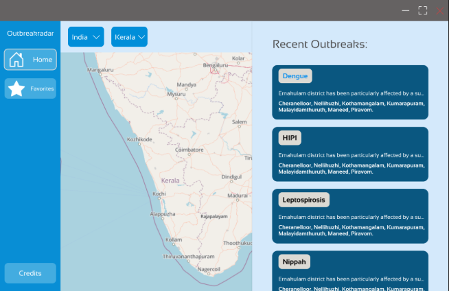
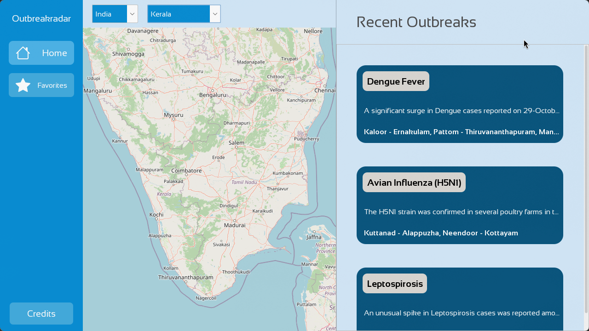
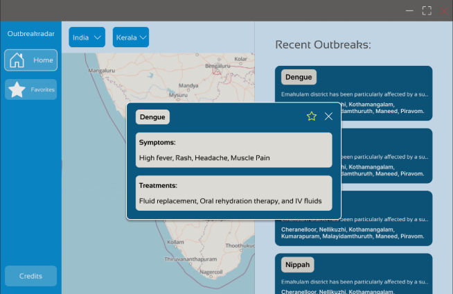
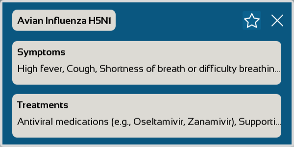
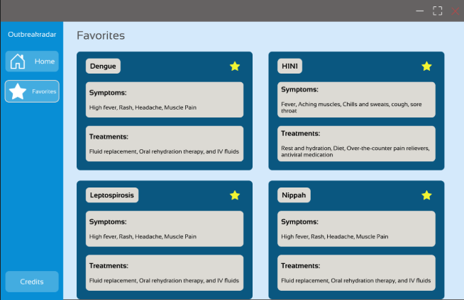
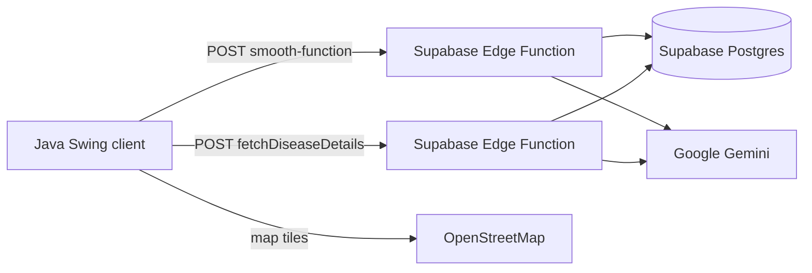

<h1 align="center">Outbreakradar</h1>

<p align="center">
  <strong>A handwritten desktop dashboard for tracking disease outbreaks across India.</strong><br>
  Designed by hand in Figma · Built by hand in Java · Powered by Supabase and Gemini
</p>

<p align="center">
  <a href="https://www.figma.com/design/WboUmNy8rzqCA9kCFHzg1V/Outbreakradar?node-id=0-1&amp;t=9YZhm2CxgS7CRsnQ-1"></a>
  
  
  
  
</p>

---

**Outbreakradar** puts recent disease outbreaks on the map. Pick an Indian state and the app fetches an AI-generated outbreak summary, recentres an OpenStreetMap map, and lists every outbreak in a scrollable feed. Click a disease name to open a modal with its symptoms and treatments.

It is deliberately old-school in the best way: the interface was drawn by hand in Figma before development, and the desktop client is **handwritten Java/Swing** rather than a generated UI.

> **Status:** the Home and Disease details screens are live. Favorites is designed and stubbed — see the [roadmap](#roadmap).

## Handwritten, through and through

- **Handmade design first.** Every frame — Home, Disease details, Favorites — was designed by hand in Figma before the first line of Java was written. [Open the Figma file →](https://www.figma.com/design/WboUmNy8rzqCA9kCFHzg1V/Outbreakradar?node-id=0-1&t=9YZhm2CxgS7CRsnQ-1)
- **Handwritten desktop client.** The app is plain Java 21 + Swing. No scene builder, no UI generator, no template: every screen, card, button and dialog is assembled in code.
- **Custom-painted components.** The rounded cards and buttons are implemented by hand in `JPanelRounded` and `JButtonRounded`; the palette, type scale and shared fonts are hand-tuned in `Constants.java`.
- **Hand-wired behaviour.** Sidebar navigation, state selection, clickable disease chips, the modal, and map pan/zoom are all wired directly with Swing listeners.

## Design vs. implementation

The Figma file contains three frames. Here is each one next to what is running today.

| Handmade Figma design | Handwritten app |
|:---:|:---:|
| <br>**Home** | <br>**Home** — live data and a real map |
| <br>**Disease details** | <br>**Disease details** — live Gemini response |
| <br>**Favorites** | <br><br>🚧 **In progress**<br>The frame is ready; the Swing screen is still a placeholder. See the [roadmap](#roadmap).<br><br> |

<sub>The app screenshot is a live run, so its disease list differs from the sample content in the Figma frames; the layout is what is being compared.</sub>

**What carried over**

- The 180 px blue sidebar, light-blue canvas, navy outbreak cards and cream disease-name pills.
- Sansation typography, rounded corners and generous spacing.
- The star and close controls in the details dialog.
- The information order on each card: disease → description → affected locations.

**What changed on the way to code**

- The static map in Figma became a real OpenStreetMap viewer with pan, wheel zoom and per-state recentring.
- Sample content became live, AI-generated data from Supabase, cached per state for the session.
- Long descriptions and locations are truncated with ellipses, with the full text in tooltips.
- The details frame became a modal `JDialog` instead of an overlay.

## Features

- 🗺️ **Interactive map** — OpenStreetMap tiles via JXMapViewer2, with pan, zoom and automatic recentring when the state changes.
- 📍 **State / UT picker** — country and state dropdowns loaded from `states.txt`, backed by coordinates for the states and union territories.
- 🦠 **Recent outbreak feed** — a cached, scrollable list of outbreaks for the selected state, fetched from a Supabase Edge Function.
- 💊 **Disease details** — click any disease to fetch symptoms and treatments and show them in a rounded modal.
- 🎨 **Handmade UI** — custom-painted rounded panels and buttons, hand-picked palette, Sansation type.
- ⚡ **Fast repeat loads** — `OutbreakManager` caches results per state for the session.

## Tech stack

| Layer | Technology |
|---|---|
| Language | Java 21 |
| UI | Swing + FlatLaf (Light) |
| Map | JXMapViewer2 + OpenStreetMap tiles |
| JSON | Gson |
| Backend | Supabase Edge Functions (Deno/TypeScript) + Postgres |
| AI | Google Gemini 3.6 Flash (primary), 3.8 Flash (fallback) |
| Design | Figma, handmade |

## How it works

1. `RecentComponent` asks `OutbreakManager` for the selected state's outbreaks.
2. `OutbreakManager` POSTs `{"location":"<state>"}` to the `smooth-function` Edge Function and caches the resulting array per state.
3. The function reuses the stored row when it is less than a week old; otherwise it generates a structured summary with Gemini and saves it to Postgres.
4. `MapComponent` recentres the map to the selected state using the coordinates in `latLong`.
5. Clicking a disease chip opens `DiseaseAlertBox`, which calls `fetchDiseaseDetails` with `{"name":"<disease>"}` and renders the returned symptoms and treatments.



## Project layout

```text
Outbreakradar/
├── build.gradle                     # Java + application plugin
├── docs/                            # design and implementation screenshots
├── gradlew, gradlew.bat            # Gradle wrapper
└── src/main/
    ├── java/io/github/Outbreakradar/
    │   ├── Main.java                # entry point
    │   ├── BaseScreen.java          # JFrame + handwritten sidebar
    │   ├── HomeScreen.java          # map + feed layout
    │   ├── MapComponent.java        # OpenStreetMap viewer + pickers
    │   ├── RecentComponent.java     # outbreak cards + scroll pane
    │   ├── DiseaseAlertBox.java     # disease details modal
    │   ├── FavoritesScreen.java     # favorites screen (in progress)
    │   ├── OutbreakManager.java     # smooth-function client + cache
    │   ├── Disease.java             # disease model + details request
    │   ├── Outbreak.java            # outbreak model
    │   ├── OutbreakJson.java        # edge-function response DTO
    │   ├── Location.java            # country/state/place model
    │   ├── Constants.java           # palette, fonts, spacing
    │   ├── JButtonRounded.java      # custom-painted rounded button
    │   └── JPanelRounded.java       # custom-painted rounded panel
    └── resources/                   # icons, Sansation font, states.txt
```

> `MainTest.java` and `favorites.java` are early experiments kept for reference: a layout playground and an SQLite favorites prototype.

## Getting started

### Prerequisites

- **JDK 21** (`java -version`)
- An internet connection (map tiles + Supabase functions)
- No database setup — the app talks to the hosted Supabase project

### Run

```bash
git clone https://github.com/Outbreakradar/Outbreakradar.git
cd Outbreakradar

./gradlew run
```

On Windows use `gradlew.bat run`. The Gradle wrapper downloads Gradle and all dependencies on the first run.

You can also open the project in IntelliJ IDEA and run `io.github.Outbreakradar.Main` directly. The app reads its fonts from `src/main/resources/Sansation-Font/`, so keep the project directory as the working directory.

### Build only

```bash
./gradlew build
```

## Backend

The two Edge Functions are hosted on Supabase and are not part of the desktop build. Both expect a Supabase anon JWT.

```bash
curl -X POST "$SUPABASE_URL/functions/v1/smooth-function" \
  -H "Authorization: Bearer $SUPABASE_ANON_KEY" \
  -H "Content-Type: application/json" \
  -d '{"location":"Kerala"}'
```

```json
[
  {
    "diseaseName": "Dengue Fever",
    "outbreakLocations": ["Kaloor - Ernakulam", "Pattom - Thiruvananthapuram"],
    "description": "A recent rise in cases..."
  }
]
```

```bash
curl -X POST "$SUPABASE_URL/functions/v1/fetchDiseaseDetails" \
  -H "Authorization: Bearer $SUPABASE_ANON_KEY" \
  -H "Content-Type: application/json" \
  -d '{"name":"Typhoid"}'
```

```json
{
  "name": "Typhoid",
  "symptoms": ["High fever", "Headache", "Stomach pain"],
  "treatments": ["Antibiotics", "Oral rehydration therapy"]
}
```

> The values above are illustrative. When deploying the functions, keep the Supabase service-role key and the Gemini API key in Supabase secrets rather than in source.

## Data disclaimer

Outbreak summaries and disease details are generated by Gemini. On the free tier, Google Search grounding may be unavailable (HTTP 429); when that happens `smooth-function` falls back to ungrounded generation. Treat everything in the app as informational — not medical advice — and verify against official health-authority sources before acting on it.

## Roadmap

- [ ] **Favorites** — wire the star buttons, persist starred diseases, and build the Figma favorites screen (an early SQLite prototype exists).
- [ ] **Grounded results** — restore Google Search grounding with billing enabled or a paid Gemini key.
- [ ] **Secrets** — move the service-role and Gemini keys fully into Supabase secrets.
- [ ] **Tests** — cover JSON parsing, state switching and the details modal.
- [ ] **Offline maps** — enable a local tile cache.

## Credits

- **Design and code:** the Outbreakradar team — handmade in Figma, handwritten in Java.
- **Map data:** © [OpenStreetMap](https://www.openstreetmap.org/copyright) contributors.
- **Font:** [Sansation](https://fonts.google.com/specimen/Sansation), SIL Open Font License — see `src/main/resources/Sansation-Font/OFL.txt`.
- **Libraries:** [FlatLaf](https://www.formdev.com/flatlaf/), [Gson](https://github.com/google/gson), [JXMapViewer2](https://github.com/msteiger/jxmapviewer2).
- **Backend:** [Supabase](https://supabase.com/) Edge Functions and [Google Gemini](https://ai.google.dev/).

---

<p align="center"><sub>Handwritten with care. Built one panel at a time.</sub></p>
